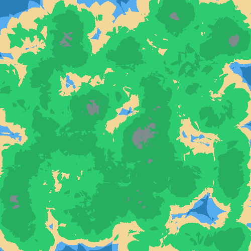

# Procedural Terrain & Bitmap Map Generator

A C++ procedural world generator that simulates particle deposition ("dirtball" drops) on a 2D elevation grid, normalizes the terrain data, renders an ASCII preview, and exports a full-color `.bmp` biome map from scratch without external graphics libraries.



## How It Works

1. **Particle Deposition Simulation (`land_raw.txt`):** Initializes a 2D heightmap array and drops a user-specified number of simulated "dirtballs" of a chosen radius across the grid—allowing particles to roll, settle, and stack into organic landmasses and mountain ridges.
2. **Array Normalization (`land_normalized.txt`):** Scans the raw elevation grid to find the peak height and normalizes every cell into a standardized scale so terrain features remain proportional regardless of map dimensions or drop count.
3. **Biome & Waterline Classification (`land_polished.txt`):** Applies a user-configured water level threshold to classify normalized elevation tiers into deep water, shallow water, coast/sand, grasslands, mountains, and snow peaks, outputting an ASCII terrain map.
4. **Raw Binary `.bmp` Encoding (`land_map.bmp`):** Translates the classified 2D terrain grid into RGB color values and writes the binary BMP file header, DIB header, row padding, and pixel array directly to disk.

## What I Learned

- **Generating Visual Output Beyond the Terminal:** Breaking out of text-only console output to generate a full-color image file (`land_map.bmp`) by constructing binary headers and pixel bytes directly in C++.
- **2D Array Management & Normalization:** Manipulating 2D elevation arrays across variable grid sizes and normalizing raw accumulation counts into a consistent range before mapping values to biomes and RGB colors.
- **Multi-Stage File I/O Pipelines:** Writing intermediate stages to `land_raw.txt`, `land_normalized.txt`, and `land_polished.txt` to inspect the heightmap math at each step and verify that the final `.bmp` output matched the underlying terrain data.

## Post-Mortem & Future Enhancements

- **Modular Architecture:** Currently, simulation, normalization, ASCII rendering, and BMP binary-writing functions live inside `dirtball.cpp`. A v2 refactor would split those responsibilities into dedicated modules (`TerrainGrid.cpp`, `Normalizer.cpp`, `BmpWriter.cpp`).
- **Land Smoothing Pass:** Adding an optional post-simulation smoothing filter (averaging adjacent cell elevations) to soften jagged particle spikes into rolling hills and natural coastlines.
- **Procedural River Generation:** Tracing downhill paths from high-elevation peaks toward the waterline using steepest-descent traversal to carve rivers and lakes into the terrain grid.
- **CLI Usability & Presets:** Adding clearer parameter descriptions, sensible default presets, and deterministic seed support for reproducible map generation.

## Build & Run

### Compile (g++)
```bash
g++ -std=c++17 -Wall -Wextra -O2 dirtball.cpp -o dirtball
```

### Run
* **Windows (PowerShell):**
  ```powershell
  .\dirtball.exe
  ```
* **Linux / macOS / Git Bash:**
  ```bash
  ./dirtball
  ```

Follow the interactive prompts for **map dimensions**, **dirtball size**, **water level**, and **number of balls to drop** to generate the intermediate `.txt` heightmaps and `land_map.bmp`.